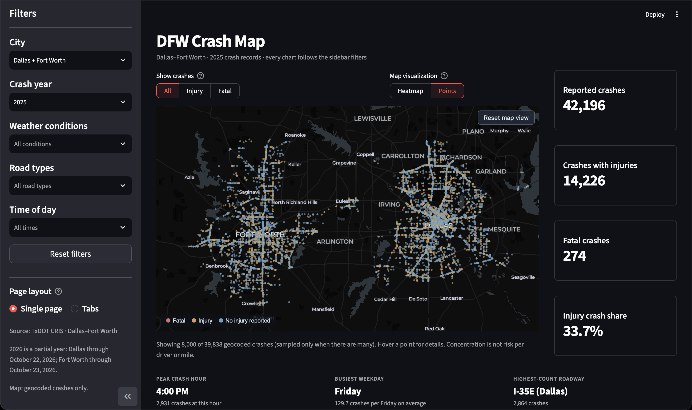
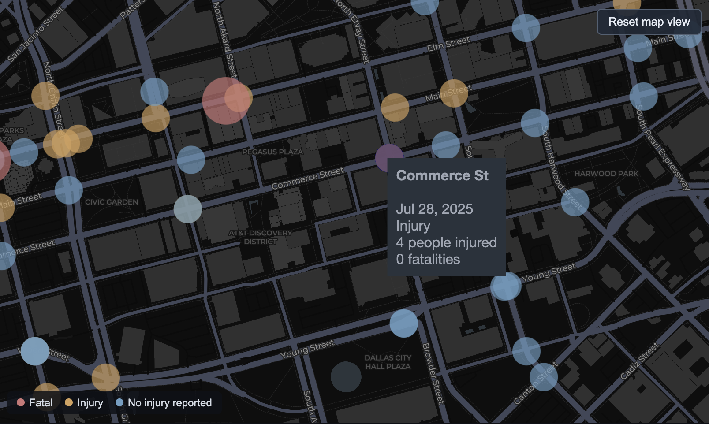
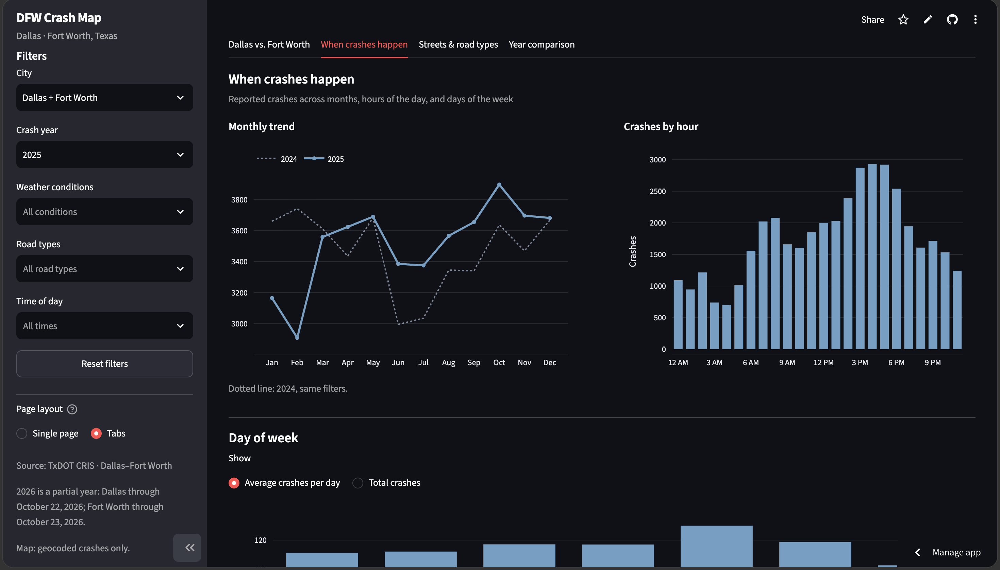

<h1 align="center">DFW Crash Map</h1>

<p align="center">An interactive look at reported traffic crashes across Dallas and Fort Worth, Texas.</p>

<p align="center">
  <a href="https://dfw-crash-map-ujqh4w6674qx5pszdlthdb.streamlit.app/">Live dashboard</a>
  · <a href="https://github.com/rahemans/dfw-crash-map">Source code</a>
</p>



## Explore the map

Zoom into individual streets, switch between points and a heatmap, or filter crashes by severity, year, weather, road type, and time of day. Crash markers show reported injury and fatality counts on hover.



## See the patterns

Go beyond locations with monthly trends, hourly and weekday breakdowns, roadway rankings, and comparisons between Dallas and Fort Worth. Export street rankings as CSV.



## Why I built it

If you've driven around DFW, you know traffic can be an experience. I wanted to go beyond complaining about it and see what the crash data actually showed. That idea became DFW Crash Map.

## Built with

**Python** · **Streamlit** · **pandas** · **NumPy** · **Plotly** · **PyDeck**

The dashboard uses Texas Department of Transportation (TxDOT) Crash Records Information System (CRIS) data. It cleans the exports, caches processed data when possible, and samples nonfatal points for map performance while retaining all fatal-crash points.

## Run locally

```bash
git clone https://github.com/rahemans/dfw-crash-map.git
cd dfw-crash-map
python3 -m venv .venv
source .venv/bin/activate
python3 -m pip install -r requirements.txt
python3 -m streamlit run app.py
```

Add your TxDOT CRIS CSV exports to `Data/`, retaining the original column names:

```text
Data/
├── dallas_crashes_2024_2026.csv
└── forthworth_crashes_2024_2026.csv
```

The `forthworth` filename matches the path expected by the app. Either city can run on its own; both files are needed for the combined view. On Windows, activate the environment with `.venv\Scripts\Activate.ps1` instead.

To run the automated tests:

```bash
python3 -m pip install pytest
python3 -m pytest -q tests/test_crash_logic.py
```

## A note on the data

The app covers the dates available in the 2024–2026 CRIS exports, which may include partial years. Only crashes with usable coordinates appear on the map; charts can include additional records. Injury and fatal crash categories can overlap.

**Crash concentration is not the same as risk.** These counts are not adjusted for traffic volume, miles driven, or road length, and the app does not predict future crashes or determine fault.

---

<sub>Independent student data science project. Not affiliated with or endorsed by TxDOT.</sub>
