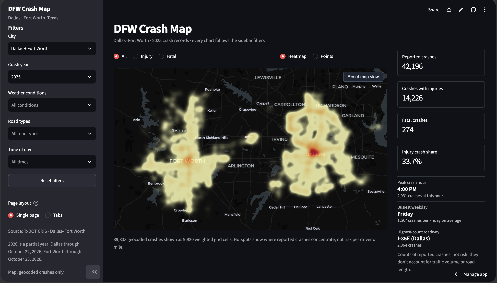

# DFW Crash Map

**Explore traffic crash patterns across Dallas and Fort Worth, Texas.**

An interactive dashboard built with Python and Streamlit to explore *where*, *when*, and *under what conditions* traffic crashes are reported. Using Texas Department of Transportation (TxDOT) Crash Records Information System (CRIS) data, the app brings crash locations, trends, severity, and roadway analysis into one place.

**[Explore the live dashboard](https://dfw-crash-map-ujqh4w6674qx5pszdlthdb.streamlit.app/)** · [View the source code](https://github.com/rahemans/dfw-crash-map)

## Dashboard preview

### Crash hotspot map

Visualize geographic concentrations of reported crashes in Dallas and Fort Worth. Switch between a heatmap and individual crash locations, and filter by city, year, weather, road type, or time of day.



### Crash trends

Compare monthly trends, explore the busiest crash hours, and examine patterns across days of the week.


## Features

| Explore | What you can do |
| --- | --- |
| **Interactive crash map** | Switch between hotspot and individual-crash views, including injury and fatal crashes. |
| **Flexible filters** | Explore Dallas, Fort Worth, or both by year, weather, roadway type, and time of day. |
| **Crash trends** | Explore monthly, hourly, and weekday patterns, including an hour-by-weekday heatmap. |
| **City comparisons** | Compare reported crash totals and injury-crash shares for Dallas and Fort Worth. |
| **Roadway analysis** | Rank streets by reported crashes, injury crashes, or fatal crashes; download rankings as CSV. |
| **Year comparisons** | Compare complete years without treating partial-year data as a full year. |

Selected filters can also be shared through the app's URL.

## Built with

**Python** · **Streamlit** · **pandas** · **NumPy** · **Plotly** · **PyDeck**

PyArrow supports optional Parquet caching to speed up subsequent data loads.

## Run locally

**1. Clone the repository**

```bash
git clone https://github.com/rahemans/dfw-crash-map.git
cd dfw-crash-map
```

**2. Create a virtual environment and install dependencies**

On macOS or Linux:

```bash
python3 -m venv .venv
source .venv/bin/activate
python3 -m pip install -r requirements.txt
```

On Windows (PowerShell):

```powershell
py -m venv .venv
.venv\Scripts\Activate.ps1
py -m pip install -r requirements.txt
```

**3. Add TxDOT CRIS data**

Place the source CSV exports in the `Data/` directory:

```text
Data/
├── dallas_crashes_2024_2026.csv
└── forthworth_crashes_2024_2026.csv
```

The `forthworth` spelling matches the path used in `app.py`. Original TxDOT field names must be preserved. The app can load either city independently; both files are needed for combined-city views.

**4. Start the dashboard**

```bash
python3 -m streamlit run app.py
```

Open the address shown in your terminal (usually `http://localhost:8501`).

## Data and interpretation

**Data source:** Texas Department of Transportation, Crash Records Information System (CRIS). The application is configured for 2024–2026 export files; the available dates depend on the actual exports, and the most recent year may be incomplete.

- Records are cleaned and standardized before analysis, including dates, hours, roadway names, and crash severity.
- The map includes crashes with valid coordinates within the DFW map bounds. Charts may include crashes that cannot be mapped.
- The hotspot visualization groups nearby crash locations into geographic cells. The individual-crash layer may sample points for rendering performance.
- Counts are **not** adjusted for traffic volume, mileage driven, roadway length, or reporting differences.

> **Important:** This dashboard describes historical **reported crashes**, not the likelihood of a future crash. It does not predict crashes, determine fault, or rank roads or cities by risk.

## Project files

```text
dfw-crash-map/
├── app.py              # Streamlit app, filtering, maps, and charts
├── Data/               # TxDOT CRIS CSV files
├── assets/             # README screenshots
├── requirements.txt    # Python dependencies
├── .gitignore
└── README.md
```

Generated Parquet files are local caches. Check TxDOT's redistribution terms before publishing source datasets.

---

*Independent student data science project. Not affiliated with or endorsed by TxDOT.*
